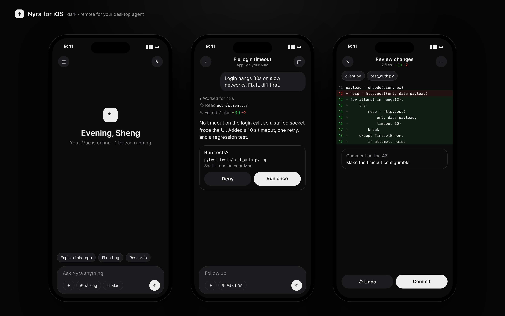
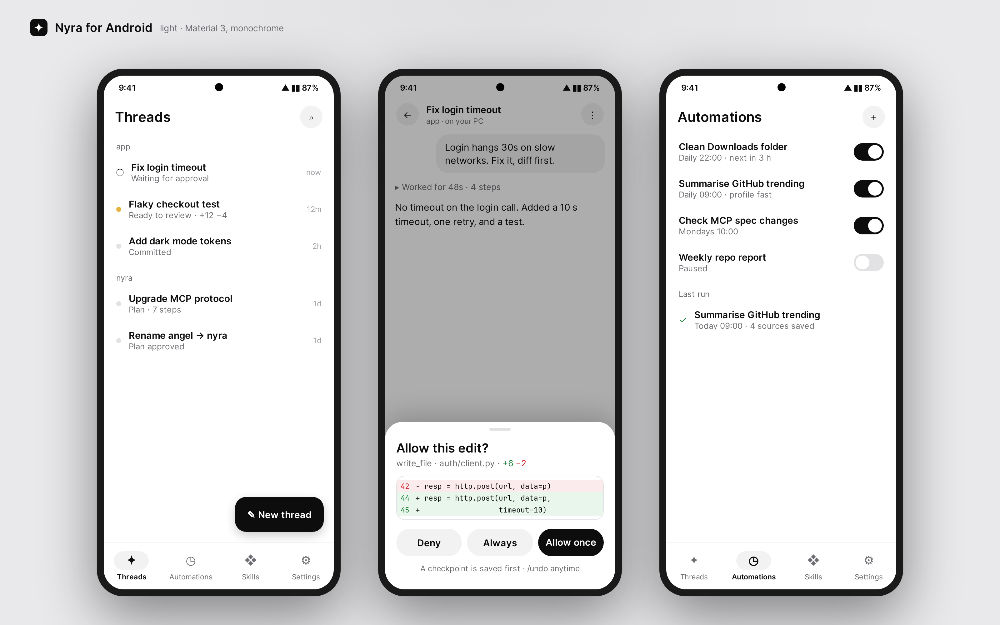

<p align="center">
  
</p>

<h1 align="center">Nyra</h1>

<p align="center">
  <b>一个跑在你电脑上的开源 AI Agent：读懂项目、改代码、跑命令、联网查证，每一步都先问你。</b><br>
  <sub>An open-source AI agent that works on your machine and asks before every action.</sub>
</p>

<p align="center">
  <a href="https://js2005happy.github.io/nyra/">官网</a> ·
  <a href="#快速开始">快速开始</a> ·
  <a href="GUIDE.md">完整手册</a> ·
  <a href="ROADMAP.md">路线图</a> ·
  <a href="CHANGELOG.md">更新日志</a>
</p>

<p align="center">
  
  
  
</p>

<p align="center">
  
</p>

<table>
  <tr>
    <td width="50%"></td>
    <td width="50%"></td>
  </tr>
  <tr>
    <td colspan="2"></td>
  </tr>
</table>

<p align="center"><sub>桌面端与移动端界面设计稿（macOS · Windows · iOS · Android），图中数据为示例。目前可用的是命令行与本地网页界面。</sub></p>

---

## 为什么是 Nyra

| | |
|---|---|
| **先问再做** | 写文件、跑命令默认逐项审批；`auto` / `readonly` / `full` 三种模式随时切换。 |
| **改错了能退** | 每次写入前自动存检查点，`/undo`、`/rewind 3` 一键回到之前，绝不覆盖别人的修改。 |
| **先计划，后执行** | `--plan` 只读生成 `plan.md`，你用 SHA-256 批准那一版，改一个字节旧批准就失效。 |
| **说话有出处** | 联网抓到的原文存为证据，结论必须附来源链接。 |
| **任意模型** | DeepSeek、Grok、OpenAI、通义、Kimi、智谱、Gemini、本地 Ollama 等 14 个预设，也能接本机 Codex 登录态；失败可自动换备用（默认关闭）。 |
| **性能优先** | 开箱即用，`git clone` 完就能跑；热点路径按性能选择最合适的语言实现。 |

## 快速开始

需要 Python 3.10+（`python3 --version` 验证）；Windows 上把下面命令里的 `python3` 换成 `python`（官网安装面板同样口径）。

```bash
git clone https://github.com/js2005happy/nyra.git nyra && cd nyra
export DEEPSEEK_API_KEY=sk-...          # 或任意已支持的模型 Key

python3 -m nyra "解释一下这个项目的结构"   # 一次性任务
python3 -m nyra                          # 交互模式
python3 -m nyra ui --open                # 本地网页界面
```

想一键装到 `~/.local/bin`（可选 systemd 服务）：见 [docs/linux-install.md](docs/linux-install.md)；已 clone 好仓库时跑 `./scripts/install.sh --source . --with-systemd`。

想让定时任务在后台一直跑（关掉终端也不停）：见 [docs/linux-systemd.md](docs/linux-systemd.md)（systemd 用户服务，不需要 root）。
想拿现成的发布包（tarball / .deb）：见 [docs/linux-packaging.md](docs/linux-packaging.md)，或跑 `./scripts/build_package.sh`。

交互模式里输入 `/help` 查看全部命令，`/status` 看 Token 用量，`/diff` 看最近一次改动。

## 它能做什么

- **编程**：读代码、`apply_patch` 精确改文件、跑测试，改动前在审批卡片里展示 diff。
- **研究**：`web_search` + `web_fetch` 联网查证，原文存档，结论附链接。
- **自动化**：内置调度器，`nyra schedule add` 按间隔或每天定时跑任务。
- **多机器人群聊**：一个房间里组长、架构师、开发者、审查员分工讨论，各自记忆与权限独立（默认只读）。
- **扩展**：接标准 MCP 服务器（stdio），用 `skills/` 与自定义斜杠命令沉淀你的做法。
- **隔离执行**：`--sandbox e2b` 让文件与命令跑在 E2B 云沙盒里，不碰本机。
- **配对码协作**：两个 Nyra 用 6 位配对码配对，宿主以只读模式跑任务、只传任务文本与结果（[手册](GUIDE.md#审批模式)）。
- **本地密码箱**：API Key 加密存在本机，不写进配置文件或聊天记录（[手册](GUIDE.md#审批模式)）。
- **本地知识库**：把文本、文件、网页收进知识库再提问，只按库内内容回答并注明依据（[手册](GUIDE.md#审批模式)）。
- **MCP 内置预置**：10 个常用 MCP 服务器开箱即用，不用手写配置（[手册](GUIDE.md#审批模式)）。

## 审批模式

| 模式 | 行为 |
|---|---|
| `readonly` | 只读文件、联网查资料，不写不执行 |
| `auto`（默认） | 写文件 / 执行命令前问你 `[y/N/a]`；无人值守时不会悄悄写入 |
| `full` | 不再确认，适合你明确信任的任务 |

```bash
python3 -m nyra --mode readonly "看看这个目录里有什么"
python3 -m nyra --plan "评估登录逻辑并列出修复步骤"
python3 -m nyra --execute-plan --approve-plan <完整 SHA-256>
```

## 配置模型

优先级：命令行参数 > 环境变量 > `~/.nyra/config.json`。Key 只从环境变量读，绝不写进文件或日志。

| Provider | 环境变量 | 默认模型 |
|---|---|---|
| deepseek（默认） | `DEEPSEEK_API_KEY` | `deepseek-flash` |
| xai（Grok） | `XAI_API_KEY` | `grok-4.3` |
| openai | `OPENAI_API_KEY` | `gpt-4o-mini` |
| qwen（通义） | `DASHSCOPE_API_KEY` | `qwen-plus` |
| kimi | `MOONSHOT_API_KEY` | `kimi-k3` |
| glm（智谱） | `ZHIPU_API_KEY` | `glm-5.3` |
| gemini | `GEMINI_API_KEY` | `gemini-2.5-flash` |
| ollama（本地） | 无需 Key | `qwen2.5:7b` |
| codex | 无需 Key（本机 Codex 登录） | `codex-default` |

另有 openrouter、mistral、groq、together 与 `custom`（`NYRA_API_KEY` + `NYRA_BASE_URL` + `NYRA_MODEL`）。`python3 -m nyra --list-providers` 查看全部，详见 [完整手册](GUIDE.md#配置模型)。

## 网页界面

```bash
python3 -m nyra ui --open
```

一个内嵌页面，不加载任何外部资源。只监听本机，每次启动生成随机访问 token。

## 安全边界

- 默认逐项审批；`a`（本会话始终允许）只对同一文件、或完全相同的命令与目录生效。
- 文件工具不能写出工作目录；MCP 子进程默认拿不到你的 API Key。
- 检查点能撤销本地文件改动，但撤销不了 shell、网络请求等外部副作用。
- 这些都不是操作系统级沙箱：运行不可信代码请用 `--sandbox e2b` 或隔离环境。

## 文档

- [完整手册](GUIDE.md)：全部功能、命令与安全说明
- [DESIGN.md](DESIGN.md)：架构与设计来源
- [ROADMAP.md](ROADMAP.md)：接下来要做什么
- [VERIFICATION.md](VERIFICATION.md)：真实环境验证记录
- [CHANGELOG.md](CHANGELOG.md)：版本变更

## 测试

```bash
python3 -m unittest discover tests   # 727 项，全部 mock，无需 Key
```

## 致谢与许可

代码全部原创，借鉴了 Codex、OpenCode、Goose、OpenHands 等开源 agent 的设计思想（来源见 [DESIGN.md](DESIGN.md)），没有复制源码。以 [MIT](LICENSE) 许可发布。
