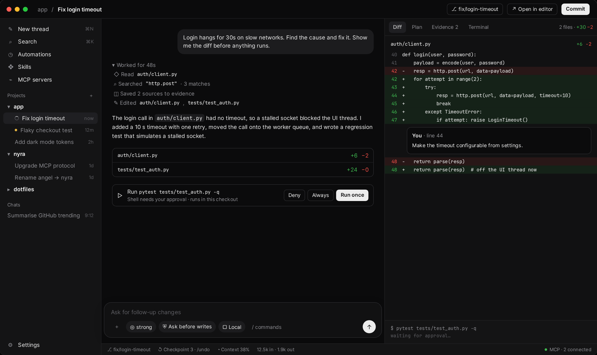
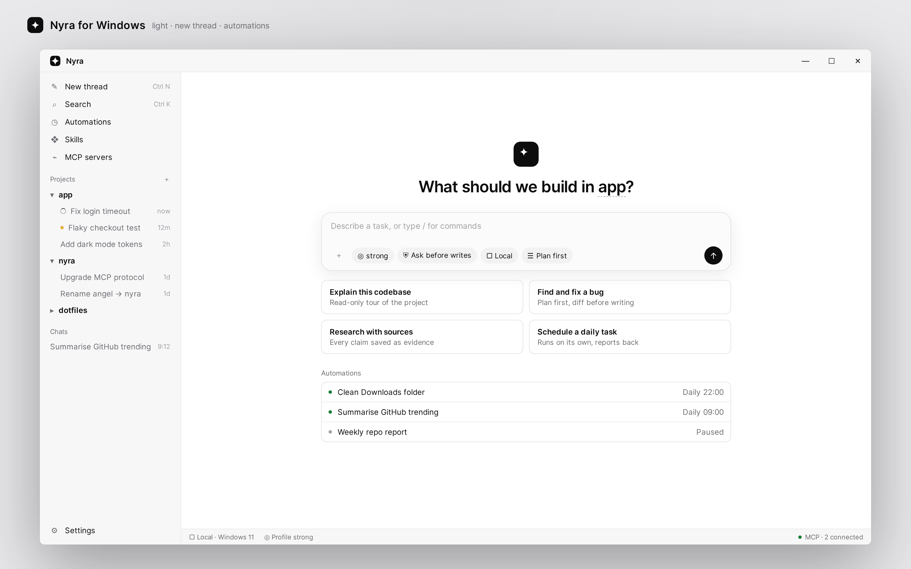

<p align="center">
  <picture>
    <source media="(prefers-color-scheme: dark)" srcset="docs/assets/nyra-mark-dark.svg">
    
  </picture>
</p>

<h1 align="center">Nyra</h1>

<p align="center">
  <b>一个跑在你电脑上的开源 AI Agent：读懂项目、改代码、跑命令、联网查证，每一步都先问你。</b><br>
  <sub>An open-source AI agent that works on your machine and asks before every action.</sub>
</p>

<p align="center">
  <a href="https://js2005happy.github.io/nyra/">官网</a> ·
  <a href="#快速开始">快速开始</a> ·
  <a href="GUIDE.md">完整手册</a> ·
  <a href="ROADMAP.md">路线图</a> ·
  <a href="CHANGELOG.md">更新日志</a>
</p>

<p align="center">
  
  
  
</p>

<p align="center">
  
</p>

<table>
  <tr>
    <td width="50%"></td>
    <td width="50%"></td>
  </tr>
  <tr>
    <td colspan="2"></td>
  </tr>
</table>

<p align="center"><sub>桌面端与移动端界面设计稿（macOS · Windows · iOS · Android），图中数据为示例。目前可用的是命令行与本地网页界面。</sub></p>

---

## 为什么是 Nyra

| | |
|---|---|
| **先问再做** | 写文件、跑命令默认逐项审批；`auto` / `readonly` / `full` 三种模式随时切换。 |
| **改错了能退** | 每次写入前自动存检查点，`/undo`、`/rewind 3` 一键回到之前，绝不覆盖别人的修改。 |
| **先计划，后执行** | `--plan` 只读生成 `plan.md`，你用 SHA-256 批准那一版，改一个字节旧批准就失效。 |
| **说话有出处** | 联网抓到的原文存为证据，结论必须附来源链接。 |
| **任意模型** | DeepSeek、Grok、OpenAI、通义、Kimi、智谱、Gemini、本地 Ollama 等 14 个预设，也能接本机 Codex 登录态；失败可自动换备用（默认关闭）。 |
| **并行产出先验收再合入** | 群聊多一个验收者角色：子 agent 的产出先过检查清单与模型复核，不通过打回重做 1 次，验收结论进证据链；默认关闭（`nyra verifier enable` 开启）。 |
| **性能优先** | 开箱即用，`git clone` 完就能跑；热点路径按性能选择最合适的语言实现。 |

## 0.4.1 更新了什么

0.4.1 是一次安全加固更新，没有改常用功能，升级后照常用（详细技术记录见 [CHANGELOG.md](CHANGELOG.md)）：

- **密码箱更难破解**：加密强度从 20 万次提到 60 万次，旧密码箱下次解锁时自动升级，不用你动手，解锁只慢约 0.4 秒。
- **主密码至少 8 位，输错 5 次会暂时锁住**：防别人乱猜你的密码，正常用不受影响。
- **配对的设备 180 天不用会自动失效**：丢了的旧手机连不上，常用设备一直用就一直有效。
- **配对码还是 6 位，好记**：错 5 次就作废，暴力猜码猜不进去。
- **联网取网页时，内网地址会被拦住**：防模型被骗去摸你内网的服务，正常上网不受影响。
- **只读操作默认只能看工作目录里的东西**：读文件、列目录、搜内容都一样，想看外面要自己放开。
- **群聊里各机器人的 Key 不再明文存文件**：改存进密码箱或本机加密，旧文件读到就自动转加密。
- **聊天记录导出存档时，里面的 Key、私钥会被删掉再存**：私钥整段删干净。
- **危险命令黑名单更严了**：`rm -r -f /` 这种变着花样的写法也能拦住，同时文档里写明它不是沙箱、拦不住存心绕过的人。
- **首次启动向导输 Key 时屏幕上只显示 `*`**：Key 只显示后 4 位；已有 Key 可以一键迁进密码箱，不用再明文躺在 shell 配置里。
- **桌面版第二次打开会直接回到已开的窗口**：不会再起一个重复的程序。
- **Windows 安装脚本加了卸载开关**：`.\install-node.ps1 -Uninstall` 一键卸载；桌面“网页界面”快捷方式指向的 `nyra ui --open` 是真实命令，点开就能用。

## 0.5.0 更新了什么

0.5.0 是一次“更好用、更省钱、更安全”的更新，常用功能照常用（详细技术记录见 [CHANGELOG.md](CHANGELOG.md)）：

- **多了 Hooks 钩子：检查不再只靠模型自觉**：工具动手之前、之后可以跑你自己写的检查脚本，不合规的直接拦住（比如写文件前先拦下含 TODO 的内容）；默认一个钩子都不装，装了才生效，钩子出问题也不会把正常任务拖死。
- **技能更省 token 了**：技能平时只留一句话简介，用到哪个才读全文；碰到匹配的文件，相关技能会自动加载，长会话更省钱、更快。
- **上下文终于看得见了**：`/context` 一眼看到上下文被系统提示、技能、对话、工具结果各占了多少；压缩后自动把你的记忆和规则读回来，不会丢；`/compact focus` 可以指定留住某部分内容再压缩。
- **命令默认进沙箱跑（Linux）**：只能动工作目录里的东西、默认断网，模型想干坏事也干不成；没装 bwrap 或在 Windows/macOS 上会自动退回工具级限制，并明确告诉你现在是哪一级隔离，不会悄悄裸奔。

## 0.5.2 更新了什么

0.5.2 是一次“补齐缺口 + 市场上线”的更新，常用功能照常用（详细技术记录见 [CHANGELOG.md](CHANGELOG.md)）：

- **内置机器人市场来了**：能装别人做好的机器人和技能包了，装之前先过三道检查（清单、危险命令扫描、独立审查），装完默认只读，不会自动跑你的东西；想发布自己的机器人也能从这儿打包。
- **授权漏洞挖掘技能包**：按范围卡做事的漏洞挖掘技能，先定范围、再证伪、提交前过七问，只报真有危害的发现。
- **Gmail 能原生接了**：Gmail 收发直接走原生接口，不用再绕路。
- **邮件能当任务入口了**：发封邮件就能派活，不用再开终端；事件符合条件也会自动进任务队列。
- **敏感动作多了一道独立审查**：对外发送、删改关键文件、跑命令之前，先有独立的审查员看一遍，拿不准就拦住；默认关闭，想开再开。
- **做完任务能自动起草技能了**：一次成功的任务做完，会自动起草一份技能草稿，人工批准后才安装；长期不用的技能会自动归档。
- **委派、审阅、模型选择也补齐了**：子任务能并行跑、审阅有队列、每个 agent 能自己选模型、改动前有影子快照能联合回滚。
- **用量看得更清楚了**：用量热力图、429 冷却、月度支出硬顶都接上了，花超了会停住，不会悄悄超支。
- **标志和终端欢迎屏统一了**：正式标志全仓统一成圆盘 + 光标，终端欢迎屏改成像素字符画，不再嵌内联图片。

## 0.5.1 更新了什么

0.5.1 是一次“补齐与更稳”的更新，常用功能照常用（详细技术记录见 [CHANGELOG.md](CHANGELOG.md)）：

- **网关里的命令也进沙箱了**：之前只有终端里的命令进沙箱，网页端、手机端发来的任务现在也一样隔离，默认断网；没装 bwrap 就退回工具级并告诉你，强制要沙箱时缺 bwrap 会直接报错停住，不会悄悄裸奔。
- **会话开始和结束时，你的检查脚本也会跑了**：钩子以前只在工具动手前后触发，现在会话一开一合也会触发（比如开局记一笔、结束时收尾）；钩子出问题不会把正常任务拖死，没装钩子时一点额外开销都没有。
- **文件级压缩也会把记忆和规则读回来了**：`nyra --compact` 压缩完同样自动读回记忆和规则，和 REPL 里 `/compact` 的行为一致，压缩失败时不读。
- **技能列表顺序统一了**：`--list-skills`、网页端状态、提示词里的技能顺序现在是同一个来源，不会各说各话。
- **模型原地打转会被拦住**：同一个失败的工具调用试 3 次就停手、换个办法；同一个答案重复 3 次提醒、10 次直接停轮，不再烧完轮数才罢休；停下来时会老实告诉你哪几步失败了、哪几步是被拦住的。
- **工具失败重试不再重复干活**：只读操作直接重试，写操作重试前先读回确认到底写没写进去，确认不了的干脆不重试；网络抖动类的错先重试两次还不行才换 provider，用量上限的错不重试。
- **安装包签名已接好线**：证书到位后，Windows 与 macOS 安装包、Windows 命令行版都会自动带签名；这版证书还没到，仍是未签名包，买证书的步骤见 `docs/SIGNING.md`。
- **Agent 不会再改自己的规则文件了**：`.git`、`.nyra`、技能目录和 `AGENTS.md` 这些路径现在默认拒写，改规则得显式放开（`NYRA_ALLOW_PROTECTED_WRITES=1`）。
- **技能能带自己的工具和模型了**：技能可以声明用哪些工具、建议用什么模型；技能正文里写的 `!命令` 会在渲染时执行，把真实仓库状态带进上下文——只有你自己家目录下的技能里的命令才会执行，仓库随带或插件里的默认不执行。
- **权限规则可以写进文件了**：学 Claude Code 的 `Tool(specifier)` 写法，allow / ask / deny 三档，deny 永远优先，规则可以随仓库提交、随团队共享。
- **子任务可以在隔离的工作区里干活了**：委派子 Agent 时可选独立 git worktree，主工作区一个字节都不动，干完把改动摘要交回你决定合不合；还能给子任务指定工具白名单和独立模型。
- **钩子能改工具入参、也能做决定了**：PreToolUse 钩子除了拦与不拦，还能在 stdout 里返回 allow/deny/ask 和改写后的入参（比如把危险的 `rm -rf` 改写成 `ls`），多个钩子取最严的决定，格式写错就当没这回事。
- **没验证通过的运行不会再自称“已完成”**：模型回复里出现“已完成”这类话，但验证没通过时，输出最前面会加一条【未验证】横幅，原文保留不删。

## 快速开始

**新用户：下载、运行，两步**（Node 单文件二进制，不用装 Python、不用装 Node）：

```bash
# 1）下载：到 https://github.com/js2005happy/nyra/releases 下最新版，
#    按平台拿一个文件（Linux x64：nyra-linux-x64；Windows：nyra-windows-x64.exe；
#    macOS arm64：nyra-macos-arm64，Intel：nyra-macos-x64）
# 2）运行（以 Linux 为例）：
chmod +x nyra-linux-x64
./nyra-linux-x64 setup      # 首次启动向导（中文，三步到第一个任务）
./nyra-linux-x64 doctor     # 中文自检：Key、网络、目录权限、磁盘
```

> 注意：Release 里已有现成二进制（最新版 v0.5.2，见下文「安装」）：Linux x64/arm64、Windows x64、macOS arm64/x64 各一个。想自己编：`bash scripts/build-binaries.sh --only linux-x64`（产物在 `dist/`，Windows/macOS 同理，只编对应目标）。

还没 Key 也能先跑 `--help` / `--version` / `--list-providers`（不联网、不花钱）。跑模型任务需要 Key：没设 Key 时会直接打印设置说明并退出（退出码 1），不会发请求、不会产生费用。没有 Key 可先用本地模型：`nyra --provider ollama "…"`（需本机装好 Ollama）或 `--provider codex`（复用本机 Codex 登录）。

> 注意：0.5.2 的 Node 二进制是完整版（agent 核心、网页界面、插件市场、创造模式都在内）。Windows/macOS 二进制未签名、未公证，首次运行会有系统提示（见各平台安装文档）。

**源码方式（想自己构建或看代码）**：见下文「安装 → 从源码构建」。

各平台的完整安装方式（一键脚本、`.deb`、桌面端、手机 PWA）见下文「安装」。

交互模式里输入 `/help` 查看全部命令，`/status` 看 Token 用量，`/diff` 看最近一次改动。

## 安装

最新版 **v0.5.2**，所有安装方式都不用装 Python、不用装 Node/Bun（Node 单文件二进制自带运行时）。装完先跑验证，再配 Key（配 Key 的方法见上文「快速开始」）：

```bash
nyra --version   # 应输出 nyra 0.5.2 (node runtime)
nyra doctor      # 中文自检：Key、网络、目录权限、磁盘
nyra setup       # 首次启动向导（中文，三步到第一个任务）
```

> **签名状态（实话）**：Windows/macOS 的 Node 二进制与桌面安装包目前**未签名、未公证**（证书待购买，见 [docs/SIGNING.md](docs/SIGNING.md)）。首次运行时系统会弹警告（Windows SmartScreen 点“更多信息 → 仍要运行”；macOS Gatekeeper 右键点二进制选“打开”放行一次），属正常，不是文件坏了。

### Windows

| 方式 | 怎么做 | 适合谁 |
| --- | --- | --- |
| Node 二进制（推荐，命令行） | 到 [Releases](https://github.com/js2005happy/nyra/releases) 下最新版，下载 `nyra-windows-x64.exe`，放到固定文件夹（如 `C:\Tools\nyra\`）并把文件夹加进 PATH | 只用命令行 |
| 一键脚本 | PowerShell 里跑 `irm https://raw.githubusercontent.com/js2005happy/nyra/main/scripts/install-node.ps1 \| iex`（装到 `~\nyra`、加 PATH、建桌面快捷方式） | 想一步到位 |
| 桌面端（带窗口） | 在 Release 里下载 `Nyra_0.5.2_x64-setup.exe` 或 `Nyra_0.5.2_x64_en-US.msi`（0.5.3 起发版时自动挂进 Release，不用再手动传） | 想要窗口界面 |

验证：`nyra --version` 应输出 `nyra 0.5.2 (node runtime)`。常见问题：exe 双击后窗口一闪而过是正常的（它是控制台程序，在 PowerShell 里跑）；SmartScreen 警告见上文。详见 [docs/windows-install.md](docs/windows-install.md)，桌面端见 [docs/desktop.md](docs/desktop.md)。

> 如实说明：Windows 二进制在 CI 的 `windows-latest` 上跑过 `--version` / `--example` 冒烟，但还没在任何一台真 Windows 电脑上跑过。装不上时把报错原文贴到仓库 issue 里。

### macOS

| 方式 | 怎么做 | 适合谁 |
| --- | --- | --- |
| Node 二进制（推荐，命令行） | `bash scripts/install-node-macos.sh`（从 Releases 下载对应架构：arm64 用 `nyra-macos-arm64`，Intel 用 `nyra-macos-x64`；装到 `~/.local/share/nyra`，链接在 `~/.local/bin/nyra`） | 只用命令行 |
| 手动下载 | 到 [Releases](https://github.com/js2005happy/nyra/releases) 下最新版，按架构下载 `nyra-macos-arm64` 或 `nyra-macos-x64`，`chmod +x` 后直接跑 | 不想跑脚本 |
| 桌面端（带窗口，`.dmg`） | 在 Release 里下载 `Nyra_<版本>_universal.dmg`（0.5.3 起发版时自动挂进 Release；0.5.2 的 `.dmg` 仍只在 Actions 产物里：仓库 **Actions → Build desktop app** → 选 `v0.5.2` 那次运行 → 底部 Artifacts 下载 `Nyra-macos-universal`，需要登录 GitHub） | 想要窗口界面 |

验证：`nyra --version` 应输出 `nyra 0.5.2 (node runtime)`。常见问题：Gatekeeper 首次运行会拦，右键点二进制选“打开”放行一次；`~/.local/bin` 不在 PATH 里时按脚本提示加到 `~/.zshrc`。`.pkg` 安装器没有。详见 [docs/macos-install.md](docs/macos-install.md)，桌面端见 [docs/desktop.md](docs/desktop.md)。

> 如实说明：macOS 安装脚本是在 Linux 上写好、只做了语法与占位替换检查，**尚未在真 Mac 上跑通过**；桌面 `.dmg` 也没有在真机上手动装过。

### Linux

| 方式 | 怎么做 | 适合谁 |
| --- | --- | --- |
| Node 二进制（推荐） | `bash scripts/install-node.sh`（从 Releases 下载对应架构：x64 用 `nyra-linux-x64`，arm64 用 `nyra-linux-arm64`；装到 `~/.local/share/nyra`，链接在 `~/.local/bin/nyra`） | 大多数人 |
| 手动下载 | 到 [Releases](https://github.com/js2005happy/nyra/releases) 下最新版，按架构下载，`chmod +x` 后直接跑 | 不想跑脚本 |
| `.deb` / tarball | 自己打出来：`bash scripts/build-binaries.sh --only linux-x64 && bash scripts/build-package-node.sh`，再 `sudo dpkg -i dist/nyra-node_0.5.2_amd64.deb`（`.deb` / tarball 不在 Release 里） | Debian/Ubuntu，想装进系统目录 |
| 调度器常驻 | 安装时加 `--with-systemd`，再 `systemctl --user enable --now nyra-scheduler.service`（只装服务文件、不自动启动；不需要 root） | 想让定时任务后台一直跑 |

验证：`nyra --version` 应输出 `nyra 0.5.2 (node runtime)`。常见问题：`nyra: command not found` 是 `~/.local/bin` 不在 PATH 里，加 `export PATH="$HOME/.local/bin:$PATH"` 到 `~/.bashrc`；没用户 systemd 总线的机器（容器、WSL 默认配置）用 `nyra schedule daemon` 在终端里跑。详见 [docs/linux-install.md](docs/linux-install.md)、[docs/linux-packaging.md](docs/linux-packaging.md)、[docs/linux-systemd.md](docs/linux-systemd.md)。

### 手机 PWA（不用应用商店）与安卓 APK

手机版是电脑上 `nyra ui` 顺带提供的手机页面（`/m`），装到主屏幕就能当 App 用：电脑上跑 `nyra ui --pair`，手机和电脑连同一个 Wi-Fi，扫终端里的二维码配对，再在浏览器里点“添加到主屏幕”（安卓 Chrome 右上角 ⋮，iPhone Safari 点分享）。没有 APK / IPA，手机直接连你电脑上的 Nyra，工具仍在电脑上执行。详见 [docs/mobile-pwa.md](docs/mobile-pwa.md)。

> 如实说明：没有在真手机上验证过（只在电脑上用 Playwright 模拟 iPhone 14 与 Pixel 7 跑过）；真机上的“添加到主屏幕”菜单、系统启动屏、iOS 独立窗口的存储行为都还没亲手试过。

**安卓 APK（0.5.3 起）**：想装真 App 而不是浏览器书签时，到 [Releases](https://github.com/js2005happy/nyra/releases) 下最新版下载 `nyra-android-debug.apk`，装到手机上，打开后填电脑的局域网地址与配对码连接（配对方法与上面 PWA 相同）。iPhone 仍用上面的 PWA（没有 IPA，要 Apple Developer 账号与证书，见 [docs/installers.md](docs/installers.md)）。

> 如实说明：APK 是 debug 签名（不是正式签名），且只在 CI 里编出来、没在真机上装过；第一次装时如有出入以手机上实际出现的为准。

### 从源码构建

```bash
git clone https://github.com/js2005happy/nyra.git nyra && cd nyra
bun run src/cli.ts "解释一下这个项目的结构"   # 一次性任务（需先装 Bun）
bun run src/cli.ts                          # 交互模式
bun run src/cli.ts ui --open                # 本地网页界面
```

只编单文件二进制：`bash scripts/build-binaries.sh --only linux-x64`（产物在 `dist/`；5 个目标：`linux-x64` / `linux-arm64` / `windows-x64` / `macos-arm64` / `macos-x64`）。Linux 桌面端（Tauri）本地编不了（缺系统库），靠 CI 构建，见 [docs/desktop.md](docs/desktop.md)。

> 0.4.0 已移除 Python 版：仓库里不再有 Python 代码，`python3 -m nyra` 不可用；唯一运行方式是 Node 单文件二进制（或上面这样用 Bun 跑源码）。

## 断点续跑与结果验证

长任务会把运行状态记在 `~/.nyra/runs/<run_id>/`（目录权限 0700，文件 0600）。单次任务和 `--json` 会打印运行 ID。

- 中途中断后用 `nyra --resume-run <run_id>` 接着跑。尚未得到结果的工具调用**不会自动重跑**（可能已经产生副作用），会先告诉模型结果未知。续跑时先前会话里放行的审批全部作废，需要重新确认。已经 `verified` 或 `completed_unverified` 的运行不能再续。
- 用 `--verify "python -m unittest"`（或配置 `verify_command`、项目 `AGENTS.md` 里的 `verify:` 行）做结果自证。验证命令在**创建任务时冻结**，之后再改 `AGENTS.md` 不算数。只有命令真实退出码 0 才是 `verified`；失败会把输出作为不可信的工具消息交回模型，最多再试 2 次，仍失败则为 `verify_failed`（`--json` 退出码 4）。没配置验证命令时状态是 `completed_unverified`，报告会写明「未验证」。模型自己说「已验证」不会改变状态。来自 `AGENTS.md` 的 `verify:` 视为外部内容：任意模式（含 `--mode full`）都要先确认一次再冻结；`--json` 或其它非交互运行需加 `--trust-agents-verify`，否则跳过该命令并记为未验证。命令行 `--verify` 和用户配置 `verify_command` 不需要这步确认。续跑只用已冻结的命令，不再读取 `AGENTS.md`。
- 后台队列：`nyra task add "任务" [--workdir D] [--verify CMD] [--mode readonly|auto] [--trust-agents-verify]` 入队；`nyra task worker [--once]` 顺序执行（同时只能有一个 worker）。遇到需要审批的操作会停下并标为 `awaiting_approval`，不会自动放行。前台用 `nyra task approve <run_id>` 继续。`nyra task list|show|cancel` 查看或取消（只能取消还在排队的任务）。定时任务到期后也会进入这个队列，且与队列一样拒绝 `full` 模式。worker 不会自动信任 `AGENTS.md` 里的验证命令，需在 `task add` 时加 `--trust-agents-verify` 或显式 `--verify`。完成通知写在 `~/.nyra/inbox.jsonl`，打开 REPL 或输入 `/status` 时会看到未读通知。

## 它能做什么

- **编程**：读代码、`apply_patch` 精确改文件、跑测试，改动前在审批卡片里展示 diff。
- **研究**：`web_search` + `web_fetch` 联网查证，原文存档，结论附链接。
- **自动化**：内置调度器，`nyra schedule add` 按间隔或每天定时跑任务。
- **多机器人群聊**：一个房间里组长、架构师、开发者、审查员分工讨论，各自记忆与权限独立（默认只读）。
- **插件市场**：只装带来源、可审计的技能包（`nyra plugin install <本地目录|git URL>`），哈希锁定、升级不覆盖你改过的文件。
- **创造模式**：一句话搓出专属插件，先验证、你确认后才安装（[手册](GUIDE.md#创造模式一句话搓出插件)）。
- **隔离执行**：`--sandbox` 支持 `auto`（默认）/ `local` / `bwrap`（Linux）/ `seatbelt`（macOS）/ `jobobject`（Windows）；`auto` 在 Linux 且有 bwrap 时用 bwrap，否则退回工具级限制并明确告诉你，不会悄悄裸奔。0.3.0 的 `--sandbox e2b`（E2B 云沙盒）已在 0.4.0 移除，Node 版 E2B 后端尚未移植，显式 `--sandbox e2b` 会直接报错。
- **配对码协作**：两个 Nyra 用 6 位配对码配对，宿主以只读模式跑任务、只传任务文本与结果（[手册](GUIDE.md#审批模式)）。
- **本地密码箱**：API Key 加密存在本机，不写进配置文件或聊天记录（[手册](GUIDE.md#审批模式)）。
- **本地知识库**：把文本、文件、网页收进知识库再提问，只按库内内容回答并注明依据（[手册](GUIDE.md#审批模式)）。
- **MCP 内置预置**：10 个常用 MCP 服务器开箱即用，不用手写配置（[手册](GUIDE.md#审批模式)）。

## 审批模式

| 模式 | 行为 |
|---|---|
| `readonly` | 只读文件、联网查资料，不写不执行 |
| `auto`（默认） | 写文件 / 执行命令前问你 `[y/N/a]`；无人值守时不会悄悄写入 |
| `full` | 不再确认，适合你明确信任的任务 |
| `creator`（创造模式） | 一句话做插件：先对齐 spec、生成、验证，安装前请你确认；写文件/执行命令时与 `auto` 一样逐项确认 |

```bash
nyra --mode readonly "看看这个目录里有什么"
nyra --plan "评估登录逻辑并列出修复步骤"
nyra --execute-plan --approve-plan <完整 SHA-256>
```

## 配置模型

优先级：命令行参数 > 环境变量 > `~/.nyra/config.json`。Key 只从环境变量读，绝不写进文件或日志。

| Provider | 环境变量 | 默认模型 |
|---|---|---|
| deepseek（默认） | `DEEPSEEK_API_KEY` | `deepseek-flash` |
| xai（Grok） | `XAI_API_KEY` | `grok-4.3` |
| openai | `OPENAI_API_KEY` | `gpt-4o-mini` |
| qwen（通义） | `DASHSCOPE_API_KEY` | `qwen-plus` |
| kimi | `MOONSHOT_API_KEY` | `kimi-k3` |
| glm（智谱） | `ZHIPU_API_KEY` | `glm-5.3` |
| gemini | `GEMINI_API_KEY` | `gemini-2.5-flash` |
| ollama（本地） | 无需 Key | `qwen2.5:7b` |
| codex | 无需 Key（本机 Codex 登录） | `codex-default` |

另有 openrouter、mistral、groq、together 与 `custom`（`NYRA_API_KEY` + `NYRA_BASE_URL` + `NYRA_MODEL`）。`nyra --list-providers` 查看全部，详见 [完整手册](GUIDE.md#配置模型)。

## 网页界面

```bash
nyra ui --open
```

一个内嵌页面，不加载任何外部资源（字体随包内嵌）。只监听本机，每次启动生成随机访问 token。

桌面端 v2 按定稿设计稿实现（黑白极简，浅色/深色跟随系统）：左侧按项目分组的会话列表；对话流里工具调用折叠成步骤行，写文件、跑命令前出现审批卡片（拒绝 / 本会话始终允许 / 允许一次，附真实 diff）；右侧审阅面板看改动 diff、计划、证据、终端输出与 Token 用量；输入框可切审批模式、选模型、开计划模式（先只读写出 `plan.md`，审核后按 SHA-256 执行）。Key 只从环境变量读，页面不输入也不保存。手机宽度可用，全键盘可操作。详见 [完整手册](GUIDE.md#网页界面)。

### 桌面 App（预览，macOS / Windows）

`desktop/` 里是用 Tauri 2（Rust + 系统 WebView）做的原生外壳：打开后在后台启动本机的 `nyra ui`（只绑 127.0.0.1、随机端口与 token），窗口直接显示它，退出时一并关闭；找不到 Nyra 二进制时显示安装引导。Windows 安装包（`.msi` / NSIS `.exe`）与 macOS `.dmg` 在 Release 里直接下载（0.5.3 起发版时自动挂进 Release；0.5.2 的 `.dmg` 仍只在 Actions 产物里）；两个包都**未签名**。安装与打开未签名 App 的步骤见 [docs/desktop.md](docs/desktop.md)。

## 安全边界

- 默认逐项审批；`a`（本会话始终允许）只对同一文件、或完全相同的命令与目录生效。
- 文件工具不能写出工作目录；MCP 子进程默认拿不到你的 API Key。
- 检查点能撤销本地文件改动，但撤销不了 shell、网络请求等外部副作用。
- 命令默认走沙箱（见上文“隔离执行”）；但沙箱不是万能的，运行不可信代码请再加一层隔离环境。

## 文档

- [完整手册](GUIDE.md)：全部功能、命令与安全说明
- [DESIGN.md](DESIGN.md)：架构与设计来源
- [ROADMAP.md](ROADMAP.md)：接下来要做什么
- [VERIFICATION.md](VERIFICATION.md)：真实环境验证记录
- [CHANGELOG.md](CHANGELOG.md)：版本变更
- [docs/desktop.md](docs/desktop.md)：桌面 App（macOS / Windows，预览）
- [docs/windows-install.md](docs/windows-install.md)、[docs/macos-install.md](docs/macos-install.md)、[docs/linux-install.md](docs/linux-install.md)：各平台安装
- [docs/linux-packaging.md](docs/linux-packaging.md)：tarball 与 `.deb` 打包
- [docs/linux-systemd.md](docs/linux-systemd.md)：systemd 调度器服务
- [docs/mobile-pwa.md](docs/mobile-pwa.md)：手机 PWA

## 测试

```bash
bun x tsc -p tsconfig.json --noEmit   # 类型检查
bun test tests/node                    # Node 测试（全部 mock，无需 Key）
```

## 致谢与许可

代码全部原创，借鉴了 Codex、OpenCode、Goose、OpenHands 等开源 agent 的设计思想（来源见 [DESIGN.md](DESIGN.md)），没有复制源码。以 [MIT](LICENSE) 许可发布。

## 命令索引

全部子命令见 [docs/COMMANDS.md](./docs/COMMANDS.md)（由测试机械校验与代码一致）。
